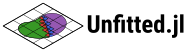

<p align="center">
  <picture>
    <source media="(prefers-color-scheme: dark)" srcset="resources/logo-dark.svg">
    
  </picture>
</p>

> [!WARNING]
> **Early development.** Unfitted.jl is under active development and has not had a stable release yet. The public API,
> default values, and numerical conventions can change between commits without prior notice. Pin a specific commit if
> you need reproducibility, and review the diff before updating.

A compact, dimension-generic Julia implementation of **unfitted multi-level hp refinement** on axis-aligned Cartesian
grids, with **selective per-cell activation** and **finite-cell-method (FCM) immersed-boundary integration** by compact,
non-negative cut-cell quadrature.

## Method reference

The method is described in

> J. N. Schmäke and M. Ruess, *Unfitted Multi-Level hp Refinement for Localized and Moving Solution Features*, arXiv
> preprint [arXiv:2604.25797](https://arxiv.org/abs/2604.25797).

## What's in the package

- **Unfitted Multi-level hp refinement by superposition**: overlays are independent levels added on top of a base mesh,
  with no hanging-node constraints ([`tutorials/02_overlays`](examples/tutorials/02_overlays)).
- **Selective per-cell activation**: switch individual cells of any level on and off, for instance as a solution feature
  moves.
- **Immersed boundaries (finite cell method)**: geometry as a CSG level set or a closed boundary mesh; cut cells get a
  compact quadrature rule with non-negative weights ([`tutorials/03_immersed_fcm`](examples/tutorials/03_immersed_fcm)).
- **Two basis families**: hierarchical integrated Legendre, and B-splines whose superposition is `C^(p−1)` under any
  activation pattern ([`tutorials/04_bspline`](examples/tutorials/04_bspline)).
- **Per-cell polynomial order** for the integrated Legendre family.
- **Nested refinement ladders**: declare a stack of aligned levels and switch its cells on per level
  ([`tutorials/05_ladders`](examples/tutorials/05_ladders)).
- **Automated hp adaptivity**: error estimation, marking, and an h-or-p decision per cell
  ([`tutorials/06_adaptive_hp`](examples/tutorials/06_adaptive_hp)).
- **Multi-domain coupling**: independently meshed subdomains tied across an interface by a user-supplied two-sided form
  ([`applications/interface_coupling_2d`](examples/applications/interface_coupling_2d)).
- **Post-processing**: point evaluation, L² errors, boundary integrals, ParaView output, and Makie plots in 1D and 2D.
- **Dimension-generic**: the same code runs in 1D, 2D, 3D, and 4D.

## Installation

Unfitted.jl is not yet registered. Add it directly from the repository:

```julia
import Pkg
Pkg.add(url="https://github.com/schmaeke/Unfitted.jl")
```

Julia 1.10 or newer is required. The optional integrations are package extensions and load with their package: add
`WriteVTK` to your environment (`Pkg.add("WriteVTK")`) for ParaView output, as the quick example below uses,
`CairoMakie` (or another Makie backend) for plots, `BasicBSpline` for the B-spline family, `FileIO` + `MeshIO` for
imported boundary meshes, and `Tensors` for weak forms in tensor notation.

## Quick example

Poisson on a square plate with a circular hole. The plate's outer edge is a face of the background box and carries a
Dirichlet condition; the hole is immersed — the mesh knows nothing about it — and is left free.

```julia
using Unfitted
using WriteVTK   # loads Unfitted's ParaView writer, a package extension

# The background box. It is meshed regardless of the geometry, which is what
# makes the method unfitted: cells may be inside Ω, outside it, or cut by ∂Ω.
omega = box((-1.0, -1.0), (1.0, 1.0))

# Ω = { x : φ(x) ≤ 0 } ∩ omega, so this φ keeps the square *minus* a disk of
# radius 0.7. φ is a signed distance, so `lipschitz = 1` lets the cell
# classifier and the quadrature kernel prove its sign on a box instead of
# guessing it from corner samples; `subcell_length_scale` is the box size they
# subdivide down to where they cannot.
plate = physical_domain(x -> 0.7 - sqrt(x[1]^2 + x[2]^2); lipschitz=1.0,
                        subcell_length_scale=0.02)

# 16×16 cells of quadratic integrated Legendre. Cells wholly outside Ω are
# dropped; a cut cell gets Saye's implicit quadrature on its part of Ω instead
# of tensor Gauss, pruned to a subset of its points with the same moments and
# non-negative weights. `u` is the unknown field on that space — scalar unless
# you ask for components.
V = space(omega; cells=(16, 16), order=2, physical=plate)
u = field(:u, V)

# The weak form, assembled term by term: `blocks` are bilinear (here ∫ ∇u·∇v),
# `loads` are linear (∫ f v with f ≡ 1), and `dirichlet` is imposed strongly by
# eliminating the constrained dofs rather than by penalty.
problem = Problem((u,);
                  blocks    = (stiffness_block(u),),
                  loads     = (source_load(u; source = 1.0),),
                  dirichlet = [dirichlet(0.0; on=boundary(:all))])

# `prepare` does the geometry once — classify cells, build integration regions
# and cut-cell rules, number the dofs, resolve constraints. `solve!` assembles
# and factorises. `report` carries the numbers you need to trust the run:
# active unknowns, cut-region and fit-failure counts, residual norm.
model    = prepare(problem)
solution = solve!(model)
report   = diagnostics(model, solution)

# A ParaView bundle: `plate.vtm` and its pieces, written by the WriteVTK
# extension that `using WriteVTK` loaded. The field is sampled on a
# subdivided grid, since a p = 2 basis is not linear across a cell. The mesh
# itself is written as whole cells carrying an `active` flag — cut cells are
# not clipped — so the hole reads as the 76 of 256 cells the fold dropped.
write_vtk("plate", solution, model)
```

`boundary(:all)` selects faces of the background box `omega`, never the immersed boundary. A condition on the hole is
imposed weakly instead, as [`tutorials/03_immersed_fcm`](examples/tutorials/03_immersed_fcm) shows.

## Examples

[`examples/`](examples) holds runnable scripts in three tiers:

- **[Tutorials](examples/tutorials)** teach the API one concept at a time and are meant to be read in order.
- **[Applications](examples/applications)** solve recognisable engineering problems, some alongside third-party Julia
  packages.
- **[Reproductions](examples/reproductions)** are the scientific record: fixed benchmarks from the method paper and the
  literature, and the package's adaptivity benchmarks, one of them scored against deal.II's step-27.

Each example has its own `Project.toml`, so its dependencies stay out of your environment and install on the first run.
Examples need Julia 1.11 or newer. Run one with

```bash
julia --project=examples/tutorials/01_first_solve examples/tutorials/01_first_solve/01_first_solve.jl
```

Every other example runs the same way, with its own `<tier>/<name>` in both paths.

## Documentation

Source files are the primary documentation. Every public symbol carries a docstring; non-trivial internal helpers carry
leading comment blocks explaining the math, the algorithmic choices, or both.

For project goals, mathematical contracts, code style, testing standards, and the contributor / PR workflow, see
[`CONTRIBUTING.md`](CONTRIBUTING.md).

## Citing

If you use Unfitted.jl in academic work, please cite the method paper:

> J. N. Schmäke and M. Ruess, *Unfitted Multi-Level hp Refinement for Localized and Moving Solution Features*,
> arXiv:2604.25797.

A machine-readable record is available in [`CITATION.cff`](CITATION.cff).

## License and attribution

Unfitted.jl is distributed under the MIT License (see [`LICENSE.md`](LICENSE.md)).

The optional non-negative least-squares compression `NonnegativeFit` in `src/fcm.jl` is informed by
[QuESo](https://github.com/manuelmessmer/QuESo) (BSD-4-Clause), used as an algorithmic reference only (no code
vendored); the default compression is Carathéodory pruning, and the cut-cell moments come from Saye's implicit
quadrature. See [`NOTICE.md`](NOTICE.md) for the full upstream attribution.
